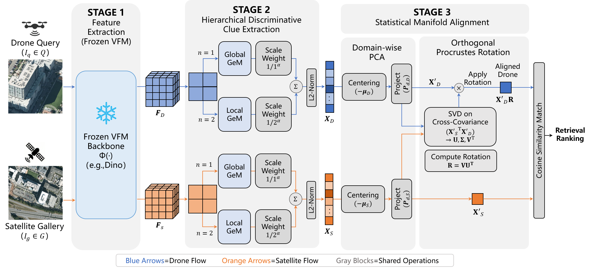
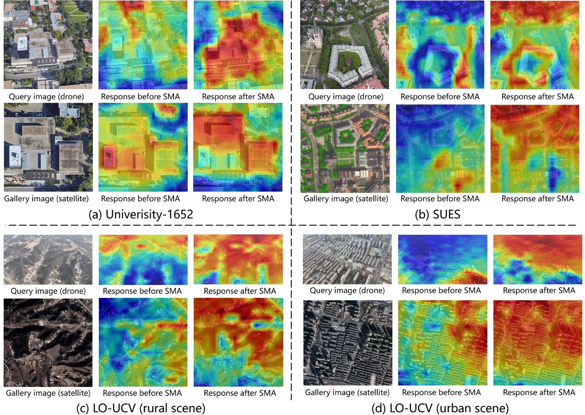

# VFM-Loc

PyTorch release for the paper **[VFM-Loc: Training-Free Cross-View Geo-Localization via Aligning Discriminative Visual Hierarchies](https://ieeexplore.ieee.org/document/11755561)** (IEEE Transactions on Geoscience and Remote Sensing, 2026).

- Training-free
- PyTorch implementation for VFM-Loc



## Installation

```bash
pip install -r requirements.txt
```

## Data Directory

Edit:

```yaml
configs/base/eval_base.yaml
```

and change:

```yaml
dataset:
  data_root: /path/to/your/University/
```

You can also override `dataset.data_root` in any file under `configs/eval/`.

Pretrained checkpoints should be placed under `pretrained_weights/`, for example:

```text
pretrained_weights/
└── dinov3/
    └── dinov3_vitb16_pretrain_lvd1689m-73cec8be.pth
```

## Evaluation

```bash
python eval.py --config configs/eval/u1652_dinov3_inference.yaml
```

Other examples:

- `configs/eval/cvusa_dinov3_inference.yaml`
- `configs/eval/cvact_dinov3_inference.yaml`
- `configs/eval/vigor_same_dinov3_inference.yaml`

## Visualization

### Regional Similarity



## Notes

- This release is focused on the **training-free** VFM-Loc pipeline.
- `eval.py` is the recommended entry point.
- The release implementation no longer depends on `VFM_CVGL/core/dinov3`.
- The **LO-UCV** dataset will be released.
- Additional backbones such as **Radio** will be added.

## Coming Soon

- LO-UCV dataset release
- Radio backbone support
- More training-free evaluation configs

## Citation

```bibtex
@article{lu2026vfmloc,
  title   = {VFM-Loc: Training-Free Cross-View Geo-Localization via Aligning Discriminative Visual Hierarchies},
  author  = {Jun Lu and Zehao Sang and Haoqi Wei and Xiangyun Liu and Kun Zhu and Haitao Guo and Zhihui Gong and Lei Ding},
  journal = {IEEE Transactions on Geoscience and Remote Sensing},
  year    = {2026},
  pages   = {1--1},
  doi     = {10.1109/TGRS.2026.3748024},
  url     = {https://ieeexplore.ieee.org/document/11755561}
}
```
